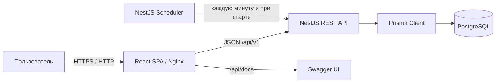
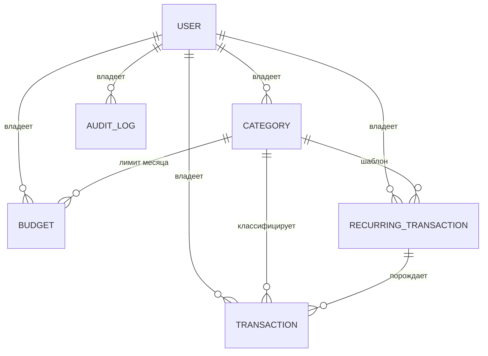

# Отчёт о разработке

## Использованные AI-инструменты
- Codex в режиме TUI с подпиской Plus, модели ChatGPT-5.6-Sol, ChatGPT-5.6-Luna, ChatGPT-6-Sol (для разработки)
- Чат-боты DeepSeek, ChatGPT (для обсуждения предожений агента)
- OpenCode, модель DeepSeek V4.1 Flash Free (для контрольной проверки кода в процессе, для разработки не применяла, редактирования markdown-разметки в отчете и диаграмм для отчета)

## Ход работы
### Начало работы: 
Придумала название - в режиме чат-бота с DeepSeek.
Репозиторий на гитхабе и в папке проекта инициализировала руками.
Запустила Codex в папку, сделала /init, чтобы создалась базовая версия AGENTS.md (потом подкорректирую)
Попросила Codex сделать initial commit и запушить на гитхаб.
Скормила Codex'y задание и попросила его подобрать технологии, результат лег в файл [`TECH_STACK.md`](./docs/TECH_STACK.md)(в качестве ответа он выдал сравнение инструментов, но я приняла его итоговую рекомендацию)

### Настройка Codex: 
Вместе с Codex сократила и адаптировала к принятым технологиям AGENTS.md
Опять же вместе с Codex разработала набор rules (дополнительно показала в режиме чат-бота DeepSeek'y)
Вместе с Codex определили, какие скиллы могут быть полезны, Сodex по моей просьбе составил анализ, определили 6 штук:
- `tdd-workflow`
- `api-design`
- `frontend-patterns`
- `verification-loop`
- `prisma-client-api`
- `prisma-cli`

Первые четыре Codex сделал сам, я их просто прочитала и одобрила, две штуки (для работы с prism) - Codex установил из официальных источников (https://github.com/prisma/skills).

Попросила Codex подключить два mcp-сервера: Context7 и Playwright MCP, он все сделал сам, все подключилось.

### Планирование: 

Попросила Codex еще раз изучить требования к проекту и предложить описание архитектуры с учетом выбранного технологического стека. Отдельно указала как целевую задачу буквальное следование всем требованиям, указанным в задании. Результат - файл [`ARCHITECTURE.md`](./ARCHITECTURE.md). Предложенный в этом файле план реализации слишком укрупненный, работать по такому неудобно, поэтому попросила Codex детализировать и сделать отдельный документ - [`IMPLEMENTATION_PLAN.md`](./docs/IMPLEMENTATION_PLAN.md).
**Наблюдение** изначально не просила Codex включать в `ARCHITECTURE.md` план реализации, он видимо вычитал это в требованиях и добавил соответственно п.14. Но мне удобнее, когда план отдельно и детальный, поэтому попросила его детализировать и вытащить в отдельный документ. Но в архитектуре оставила исходный укрупненный план.

### Разработка:

Код в проекте писал только Codex: я формулировала задачи, читала отчёты и проверяла результат. Формат сложился сразу: я даю пункт плана («выполни, пожалуйста, п.7.3»), агент делает его по подпунктам и присылает отчёт, я его читаю и запускаю следующий. Когда закрывался блок первого уровня, я просила сделать коммит и push. Ниже — хронология по пунктам плана. Отчёты агента приведены цитатами: это его формулировки, а не мой текст.

**Пункты 4.2–4.3. Swagger, клиентские типы и общий контракт API.**
Агент задокументировал cookie-JWT, ответы health и ошибки, исправил схему Swagger (поле `details` было `unknown[][]` вместо `unknown[]`) и добавил генератор клиентских типов из OpenAPI с проверками `api:generate` и `api:check`, чтобы рассинхрон схемы и клиентов ловился автоматически. Рядом появился общий контракт запросов: DTO пагинации, перечисления, детерминированная сортировка, helper обновления полей и билдер фильтров транзакций.

> Из отчёта агента: «Пункт 4.2 «Swagger и клиентские типы» завершён... stale-проверка `api:check`: намеренное расхождение обнаружено, после генерации проверка зелёная».

> Из отчёта агента: «Продолжение завершено, коммит создан: `1e19233 feat(api): add Swagger and query contract foundations`. Во время проверки обнаружен и исправлен build-дефект импорта Prisma за пределами `rootDir`; совместимость builder с Prisma теперь проверяется compile-time тестом.»

**Наблюдение** Агент регулярно запускает `prettier --check` и линтеры. Exit 1 от `--check` означает не ошибку, а наличие файлов, требующих форматирования: агент сам выполняет `prettier --write`, повторяет проверку и продолжает работу — без запроса подтверждения, что соответствует политике разрешённых безопасных команд.

**Пункт 4.4. Тестовый харнесс и изоляция владельцев.**
Появилось безопасное переключение на `TEST_DATABASE_URL`, общий `create-test-application.ts`, фабрики двух пользователей и Supertest-helper для подписанного JWT в cookie.

> Из отчёта агента: «интеграционно подтверждены `400`, `401` и ownership-safe `404`... чужая существующая запись не раскрывается и возвращает обычный `404`».

**Наблюдение** При проверке зависимостей выявлена информация о компрометации пакета Zod версии 4.6.6 (если честно, просто новость прочитала и спросила у ChatGPT). Проверка package-lock.json подтвердила использование безопасной версии 4.6.5 (сначала глазами посмотрела, потом еще Codex попросила, хотя это уже избыточно). Согласно официальному разъяснению, вредоносный код не попал в npm-реестр (это ChatGPT сказал, я поверила). Для защиты от подобных атак в проекте используется npm ci (установка строго по lock-файлу) и отключение lifecycle-скриптов зависимостей через ignore-scripts=true в .npmrc.

**Пункты 5.1–5.4. Аутентификация, профиль и первый E2E.**
5.1 — регистрация, вход, выход и `/auth/me`; пароль хешируется Argon2, JWT живёт в cookie, а не в `localStorage`; после первой транзакции менять основную валюту уже нельзя.

> Из отчёта агента: «JWT хранится в `HttpOnly`, `SameSite=Strict` cookie... После первой транзакции изменение валюты возвращает `409 BASE_CURRENCY_LOCKED` без частичного обновления профиля. API возвращает только публичный профиль — без `passwordHash`, токена и JWT claims».

5.2 — frontend-каркас входа и профиля на React Hook Form + Zod. Здесь TDD сразу нашёл настоящий дефект выхода из аккаунта:

> Из отчёта агента: «RED-тест выявил реальную неполноту: `queryClient.clear()` удалял наблюдаемый auth-query целиком, поэтому интерфейс продолжал видеть прежнего пользователя, хотя приватный кэш уже исчезал».

5.3 — адаптивность и доступность auth-форм. 5.4 — Playwright поднял полный Docker Compose, проверил вход обоими seed-аккаунтами и недоступность защищённой страницы после выхода. Первый RED показал дефект самого теста:

> Из отчёта агента: «Playwright по частичному совпадению счёл label «Пароль» подходящим и для кнопки «Показать пароль». Это дефект локатора теста, не приложения».

Итог — коммит `7e3c281 feat: complete auth and profile workflow`.

**Пункты 6.1–6.4. Категории.**
Защищённый CRUD с поиском, владелец берётся из JWT, чужая категория неотличима от отсутствующей. Имя уникально внутри пользователя без учёта регистра, удаление используемой категории запрещено.

> Из отчёта агента: «Имя уникально внутри пользователя без учёта регистра — это проверяют сервис и новый индекс PostgreSQL... ошибка `409 CATEGORY_IN_USE` при удалении используемой категории».

6.2 — страница категорий с поиском, выбором иконки и цвета, формами и состояниями загрузки/пустоты/ошибки. 6.3 — адаптивная сетка и контрастность значка; форма на mobile открывается на весь экран. 6.4 — тесты и отдельный E2E на изоляцию: созданную категорию видит только владелец. Коммит `4ee4c3e feat(categories): add scoped CRUD and responsive UI`.

**Пункты 7.1–7.4. Транзакции.**
Backend: CRUD с суммой, датой, категорией, типом, валютой и курсом; `baseAmount` считает сервер, клиентские `userId` и `baseAmount` отклоняются.

> Из отчёта агента: «`baseAmount` рассчитывается на backend через `Decimal`... Чужая транзакция возвращает 404; переданные клиентом `userId` и `baseAmount` отклоняются».

7.2 — страница транзакций: таблица на desktop, карточки на mobile, фильтры и страница в URL. 7.3 — адаптивность, форматирование сумм и дат через Intl с локалью `ru-RU` и UTC для календарной даты. 7.4 — тесты и сценарий «создать → отфильтровать → изменить → удалить». Здесь был отдельный разговор про Docker: я спросила, почему агент пишет, что Docker не запущен, хотя раньше запускал его сам.

> Из отчёта агента: «Ты права: я мог попробовать запустить Docker Desktop сам. Я этого не сделал — остановился на ошибке Compose и ошибочно представил её как окончательное препятствие».

После моего «Запускай» полный прогон прошёл: 54/54 backend-теста и 8/8 браузерных. Коммит `3a9cf11 feat(transactions): add scoped CRUD and responsive UI`.

**Пункты 8.1–8.4. Аудит.**
`AuditService` получает `Prisma.TransactionClient` и пишет журнал в транзакции вызывающей операции, а не в своей, поэтому изменение и запись аудита коммитятся или откатываются вместе.

> Из отчёта агента: «Создание, изменение и удаление транзакции записывают AuditLog в той же Prisma-транзакции; ошибка записи откатывает мутацию. CREATE сохраняет `after`, UPDATE — `before` и `after`, DELETE — `before`. Снимки содержат только разрешённые поля».

8.2–8.3 — страница журнала с фильтрами, сравнением «до/после» по именованным полям, хронологией карточек на узком экране и временем в часовом поясе профиля. Здесь я задала вопрос про размер JS-бандла:

> Из отчёта агента: «Сейчас это не критичная ошибка: сборка проходит... Просто повысить порог Vite не стоит — это уберёт предупреждение, но не ускорит загрузку».

Для визуальной проверки я подключила Firefox DevTools MCP (он сначала падал, пришлось перезапускать подключение). 8.4 — интеграционные тесты на реальной PostgreSQL: снимки CREATE/UPDATE/DELETE, откат всех трёх операций при сбое аудита и видимость журнала только владельцу. Коммит `2500b74 feat(audit): add transaction change journal`.

**Пункты 9.1–9.4. Бюджеты.**
Месячные лимиты только для расходных категорий, лимит задаётся в основной валюте, прогресс считается из `baseAmount` расходных транзакций за месяц в часовом поясе пользователя.

> Из отчёта агента: «Прогресс: `spentAmount`, `remainingAmount`, `progressPercent` и `isExceeded` рассчитываются из `baseAmount` расходных транзакций. Месяц и аудит: границы месяца учитывают часовой пояс пользователя; создание, изменение и удаление записываются в аудит атомарно с операцией».

9.2 — страница бюджетов со шкалой прогресса, превышением и отдельным состоянием для нулевых расходов. 9.3 — адаптивная сетка; браузерная проверка нашла и помогла исправить дефект.

> Из отчёта агента: «текст превышения оставался чёрным. Теперь к нему и отрицательному остатку применяется цвет ошибки из MUI-темы».

9.4 — тесты и E2E, который создаёт бюджет и расход и видит, как прогресс меняется с 0% до 40%. Коммит `b17afe9 feat(budgets): add monthly budget management`.

**Пункты 10.1–10.4. Dashboard.**
Один защищённый `GET /dashboard?months=6`: суммы — десятичные строки в основной валюте, месяцы включая нулевые, top-5 категорий, все расчёты в PostgreSQL по `baseAmount`.

> Из отчёта агента: «TDD: сначала тест получил 404, затем обнаружил нулевые суммы вместо ожидаемых; после реализации целевые Supertest — 4/4».

10.2 — пять виджетов на главной. 10.3 — адаптивные графики; анимацию Recharts отключили после визуальной проверки, чтобы графики не появлялись недорисованными. 10.4 — unit/integration/component/E2E; на скриншоте нашли обрезанную подпись оси и исправили. Коммит `14987fb feat(dashboard): add financial overview and tests`.

**Пункты 11.1–11.4. CSV-импорт и экспорт.**
`POST /transaction-imports` принимает файл и JSON-сопоставление колонок, проверяет MIME, размер, UTF-8, строки и категории владельца; при ошибке не сохраняется ничего. Экспорт использует те же фильтры, что и список, и защищён от CSV formula injection.

> Из отчёта агента: «Ошибки возвращаются с номерами строк; при ошибках данные не записываются... Экспорт защищён от CSV formula injection и отдаётся с `Content-Type` и `Content-Disposition`».

11.2–11.3 — мастер импорта со шагами, вертикальным сопоставлением на mobile и загрузкой файла с клавиатуры и перетаскиванием. 11.4 — тесты, включая импорт fixture-файла через реальный API. Здесь уместно вспомнить наблюдение про токены:

**Наблюдение** При работе с Codex CLI выявлена диспропорция в потреблении лимитов: прогон тестов (36 backend + 77 frontend) расходует больше токенов, чем генерация кода. Причина — в архитектуре агента: вывод тестов загружается обратно в контекст модели, а каждый повторный запуск добавляет новые токены. Это не баг, а особенность работы LLM-агентов с большими объёмами служебного вывода.

Коммит `71acf0e feat(csv): add transaction import and filtered export`.

**Пункты 12.1–12.4. Повторяющиеся транзакции.**
CRUD шаблонов, `nextRunAt` — первый момент локальной календарной даты в часовом поясе владельца; для дней 29–31 в коротком месяце берётся последний день.

> Из отчёта агента: «`nextRunAt` рассчитывается в часовом поясе пользователя; дни 29–31 переносятся на последний день короткого месяца... При старте backend и каждую минуту он догоняет пропущенные даты... Операция, запись аудита и обновление расписания сохраняются в одной транзакции».

12.2–12.3 — страница правил со статусом, датой следующего запуска и паузой без удаления, таблица на широком экране и карточки на узком. 12.4 — тесты с фиксированными часами (обычный месяц, дни 29–31, високосный февраль, часовые пояса, `endDate`), интеграционные проверки catch-up и идемпотентности, E2E на Compose. Коммит `5dd9b57 feat(recurring): add monthly recurring transactions`.

**Пункты 13.1–13.4. Оболочка, тема, доступность и E2E.**
13.1 — рефакторинг оболочки: `AppProviders`, `AppRouter`, `ErrorBoundary`, защищённый layout, общие `PageHeader` и `ConfirmDialog`, ленивая загрузка маршрутов и тестовый render helper. 13.2 — тема приложения:

**Наблюдение** При разработке стилей (п.13.2) я задала Codex предпочтения по цветам (цветовую гамму придумала сама): тёмно-графитовый фон, тёплое золото и янтарь под старинную монету, мшистый зелёный без голубого подтона для отдельных элементов. Агент перенёс это в MUI theme и общие layout-токены дашборда.

13.3 — общие состояния загрузки/ошибки/пустоты, skip link, проверка контраста палитры, `prefers-reduced-motion`, проверка ошибок консоли в браузерных тестах. 13.4 — проекты Playwright для desktop/mobile, сквозной CRUD, скриншоты и traces только при падении. Коммит `6d23844 feat(frontend): complete responsive UI and E2E coverage`.

**Пункты 14.1–14.4. CI, Compose-приёмка, документация и финальная проверка.**
14.1 — GitHub Actions из пяти jobs: `quality`, `tests` с отдельной PostgreSQL-базой, `build`, `compose` и `e2e-smoke`. 14.2 — приёмка на чистом volume: сервисы прошли healthcheck, seed дал ожидаемые счётчики. Именно здесь не удалось подтвердить полную сборку образа `db-init` — BuildKit зависал на `exporting layers`.

**Наблюдение** При проверке Docker-сборки обнаружен служебный контейнер buildx_buildkit_default, созданный автоматически движком Docker для выполнения сборки через BuildKit (драйвер docker-container). Контейнер не является частью приложения и используется для ускорения и изоляции процессов сборки образов. Обнаружила так сказать "глазами" в интерфейсе Docker Dekstop, спросила у Codex, что это, Codex проверил и рассказал. 

По совету агента мы уменьшили `db-init`: для него выделили отдельный слой с зависимостями только backend workspace, и сборка через `--build` прошла.

> Из отчёта агента: «образ `db-init` уменьшен с 2,11 до 1,46 ГБ — примерно на 31%... frontend-инструменты в образ не попали».

14.3 — актуализация README; ссылку на видео агент не добавлял, потому что это необязательный пункт.

**Наблюдение** При подготовке документации (п.14.3 плана), последним буллитом шла ссылка на демонстрационную запись. Попросила Codex сделать такую запись с использованием Firefox Devtools mcp. Сценарий предложил Codex, я только добавила в него обзор журнала изменений. Codex справился, но съел пятичасовой лимит полностью. Готовое видео лежит в `docs/taler-demo.webm` и подписано в README.

14.4 — финальная ревизия: трассировка требований, чистый `docker compose up`, увеличенный до 120 секунд период инициализации PostgreSQL и один Playwright worker. Затем я заметила, что в коде почти нет комментариев, и попросила агента добавить короткие русские комментарии к модулям и функциям — вышло 606 строк комментариев в 204 модулях, без изменения кода. Финальные коммиты `e85e966` (CI, инфраструктура, документация, видео) и `d037c61` (комментарии) ушли в `origin/master`, и GitHub Actions прошёл все пять jobs. Напоследок агент удалил 24 временных контейнера и 23 старых образа Taler и очистил кэш сборки.

## Завершение
Для итоговой проверки развернула приложение на чистой виртуальной машине Kali Linux. Запуск docker compose up первоначально завершился ошибкой DNS-разрешения, решённой настройкой /etc/resolv.conf. Первая сборка заняла ~18 минут из-за холодного кэша и ограниченных ресурсов ВМ. После сборки все три контейнера запустились, healthcheck backend отвечал 200 OK, frontend работал в браузере. Эксперимент подтвердил воспроизводимость развёртывания одной командой.

После проверки попросила OpenCode отформатировать отчет (добавить markdown-разметку, а то у меня не везде были заголовки выделены, ссылки отмечены и т.д.) и добавить в отчет диаграммы.

## Архитектурные решения

Taler — модульный монолит из трёх частей, которые поднимаются вместе через Docker Compose: React SPA на Nginx, NestJS REST API с фоновым планировщиком и PostgreSQL под управлением Prisma. Микросервисы, Redis и очередь сообщений я сознательно не брала: для одного демонстрационного экземпляра они не давали бы доказуемой пользы, только удлиняли бы разработку. Полное описание, все API-контракты, модель данных и обоснования собраны в [ARCHITECTURE.md](./ARCHITECTURE.md); здесь — только суть.

Диаграмма и схема выполнены OpenCode. 

Поток данных:



Nginx проксирует `/api` в backend, поэтому у frontend и API один origin: это упрощает cookie-аутентификацию (JWT только в `HttpOnly`-cookie) и убирает разницу между локальным демо и production-подобным запуском.

Схема базы данных (Prisma):



Три решения определили всё остальное: каждый запрос ограничен текущим `userId`, а чужая запись возвращает такой же 404, как отсутствующая; деньги хранятся как `Decimal`, а `baseAmount` считает сервер; аудит неизменяемый — запись журнала и изменение сущности идут в одной Prisma-транзакции, поэтому при ошибке откатываются вместе.

## Возникшие проблемы и способы их решения
1. Сетевая ошибка `fetch failed` при попытке агента обратиться к mcp Context7. В процессе работы сам Codex обошел проблему, обратившись к первичной документации фреймворков. Ошибка вылечилась перезагрузкой Codex.
2. В отчете агента о выполнении п.1.2 плана (установка бекэнд-зависимостей) npm audit показал 4 high-уязвимости в транзитивных зависимостях Prisma CLI. Автоматическое исправление через npm audit fix --force предлагало откат Prisma до 6.19.3 (breaking change). Так как уязвимости затрагивают только dev-инструменты (CLI) и не влияют на рантайм приложения, согласилась с Codex не откатывать до шестой версии. Задокументировано как принятый риск
3. На Windows периодически возникает ошибка helper_unknown_error: setup refresh had errors при инициализации sandbox Codex. Проблема helper_unknown_error: setup refresh had errors проявлялась не только при запуске shell-команд, но и при чтении файлов скиллов (SKILL.md). Это известный баг Windows-песочницы (спросила в режиме чата у DeepSeek и GhatGPT), не влияющий на корректность генерируемого кода. Агент компенсирует его повторными попытками, что позволило продолжить работу без прерывания сессии. Как временное решение временно переключила sandbox = "unelevated" в конфиге Codex.
4. При выполнении п.14.2 не прошла полная сборка db-init. Агент отчитался, что все сделал, а это зависло. Попросила его поискать причину, вот что он выдал: 

```
Судя по проверке, **место на диске вряд ли было причиной**. Данные Docker перенесены на D:, где свободно около 718 ГБ; внутри виртуального диска Docker также нет признаков заполнения. Мои прежние слова о почти заполненном C: были преждевременной гипотезой — для этой сборки C: не основной диск хранения. [Docker подтверждает, что расположение диска WSL можно менять в настройках Desktop.](<https://docs.docker.com/desktop/features/wsl/>)

Более вероятно зависание Docker Desktop/BuildKit при экспорте довольно большого образа `db-init` (2,11 ГБ): оба раза сборка быстро проходила закэшированные шаги и останавливалась именно на `exporting layers`. На этом этапе Buildx загружает результат в локальное хранилище образов. [Описание этапа экспорта в Docker.](<https://docs.docker.com/reference/cli/docker/buildx/build/>)

Память могла усугубить проблему: Docker VM доступно 3,8 ГБ RAM и 1 ГБ swap. Но сообщений об OOM я не нашла, поэтому **не могу утверждать, что памяти не хватило**. Процессор как причина выглядит ещё менее вероятным, хотя нагрузку непосредственно в момент зависания мы не замеряли.

Я бы следующим шагом уменьшила образ `db-init` — сейчас в него устанавливаются зависимости всего проекта, хотя ему нужны прежде всего backend и Prisma, — и повторила сборку с наблюдением за памятью. Удалять образы или volumes наугад не стоит.
```
Я согласилась с рекомендацией уменьшить образ `db-init`, агент отработал, проверка прошла:

```
Готово: образ `db-init` уменьшен с **2,11 до 1,46 ГБ** — примерно на 31%. В /D:/Otus\_ai/Project/Taler/backend/Dockerfile для него выделен слой, устанавливающий только backend workspace; Prisma CLI и `tsx` сохранились, frontend-инструменты в образ не попали. Этот способ выбора зависимостей соответствует [документации npm](<https://docs.npmjs.com/cli/v11/commands/npm-ci/>). Описание обновлено в /D:/Otus\_ai/Project/Taler/ARCHITECTURE.md:383.
```
Если конкретнее, агент поправил Dockerfile:
```
RUN npm ci

+FROM node:24-alpine AS db-init-dependencies
+
+WORKDIR /app
+
+COPY package.json package-lock.json ./
+COPY backend/package.json backend/package.json
+COPY frontend/package.json frontend/package.json
+
+RUN npm ci --workspace=backend --include-workspace-root=false
+
 FROM dependencies AS development
 ...
-FROM dependencies AS db-init
+FROM db-init-dependencies AS db-init
```
PS: посмотрела руками размер образа в докере - агент не соврал, размер - 1,46 ГБ.

## Наблюдения

- Vitest по умолчанию запускает тестовые файлы параллельно в изолированных воркерах. Это ускоряет прогон, но создаёт накладные расходы на старт (~10 с на воркер при isolate: true). Для проекта совместно с агентом было принято решение сохранить изоляцию в пользу надёжности тестов, несмотря на предупреждение Vitest о потенциальном ускорении.

## Удачные шаги

Самым удачным решением считаю детальное предварительное планирование. После разбиения на пункты второго уровня появилась единица проверки: агенту — однозначная граница задачи, мне — понятный объём на один заход, репозиторию — тематические коммиты. Почти все пункты закрывались с первого прохода, а ошибки ловились на уровне подпункта, а не всего раздела.

Остальные удачные шаги, которые я бы повторила:

1. **Отдельный документ с планом.** `ARCHITECTURE.md` остался про «что и почему», а `IMPLEMENTATION_PLAN.md` — про «в каком порядке и когда готово». Когда план лежит отдельно и мелкими шагами, с ним можно работать буквально по строчке.
2. **Правило не трогать `REPORT.md`.** Агент не менял мой файл и не включал его в коммиты, поэтому мои заметки и его работа не смешивались, и я могла писать отчёт параллельно с разработкой.
3. **Обязательный ритуал проверок.** Перед каждым отчётом — форматирование, `lint`, `typecheck`, сборка и тесты. Отчёты агента опирались на зелёные проверки, а не на «должно работать».
4. **TDD там, где он полезен.** RED-тест несколько раз находил настоящие дефекты раньше меня — например, выход из аккаунта с неочищенным auth-query.
5. **Скиллы и MCP.** `tdd-workflow`, `api-design`, `frontend-patterns` и `verification-loop` задавали процесс, `prisma-cli` и `prisma-client-api` — корректные команды. Context7 давал первичную документацию фреймворков, Playwright MCP и Firefox DevTools MCP — браузерные проверки.
6. **Политика разрешённых команд.** Безопасные вещи вроде `prettier --write` агент делал сам, не дёргая меня на подтверждение, а destructive-команды и force push оставались под запретом.
7. **Границы тестирования.** Unit, Supertest, интеграционные на реальной PostgreSQL, component и Playwright были разделены, поэтому всегда было видно, что именно сломалось.
8. **Изоляция данных по владельцу.** Один и тот же 404 для чужой и отсутствующей записи, `userId` только из JWT — приватность и безопасность получились «бесплатно».
9. **Отдельная тестовая база `taler_test`.** Прогоны не портили демонстрационные данные.
10. **Ленивая загрузка маршрутов и `ErrorBoundary`.** Попутно сняли вопрос по размеру JS-бандла.

## Неудачные шаги
1. Неудачное решение - сразу делать приложение в докер-контейнерах вместо того, чтобы запаковать в контейнеры готовое приложение. В процессе работы Docker VHDX вырос примерно до 15,8 ГБ и занял почти весь C:, что привело к неоднократному падению самого Docker engine, необходимости ручной чистки временных файлов и замедлению работы ОС. Кроме того, образы собирались очень медленно, Codex начинал нервничать и поглощать лимиты с усиленной интенсивностью. В итоге перенесла в настройках докера путь для образов на диск D:, но непроизводительно потратила время и съела полный пятичасовой лимит только на тестирование Prisma schema+migration+seed, даже на создание коммита не хватило. Но от длительного формирования образов это не спасло, спасло только от падений докера при нехватке места. 

2. Упущение - не подумала заранее про комментарии к коду и не сразу сообразила, что их не хватает. В начале проекта, пока кода было мало, вообще не замечала проблемы - когда свежее и мало, все понятно и прозрачно. Ближе к середине проекта стало уже тяжело воспринимать, какой модуль зачем нужен и что функция делает. Пришлось просить Codex писать комментарии по существующему коду и повторно просматривать код. Надо было изначально правило задать, чтобы он сразу комментировал.

## Итоги

Проект доведён до конца по всем пунктам плана и, на мой взгляд, полностью закрывает требования задания. Приложение поднимается одной командой `docker compose up`, seed идемпотентен (2 пользователя, 12 категорий, 240 транзакций, 3 бюджета, 4 правила, 243 записи аудита), Swagger доступен по `/api/docs`, а на чистой виртуальной машине всё запустилось без ручных правок.

В числах: 27 коммитов в формате Conventional Commits, CI из пяти jobs проходит зелёным, тесты — 50 backend unit, 106 frontend, 107 backend E2E, 31 интеграционный на данных и 32 Playwright-сценария.

Главный вывод для меня не про финансовый трекер, а про способ работы. Код целиком написал агент, но результат зависел от того, что делала я: формулировала требования, строила план мелкими шагами, проверяла каждый пункт и принимала решения. Чем яснее была задача и чем меньше был шаг, тем лучше и дешевле получался результат. Самыми дорогими оказались не сложные места, а рутина: прогоны тестов, Docker-сборка и нехватка комментариев, которые пришлось добавлять задним числом. Если начинать заново, я раньше заложила бы два правила — комментировать код с первого дня и не разрабатывать сразу в контейнерах, — а остальное сложилось удачно.
